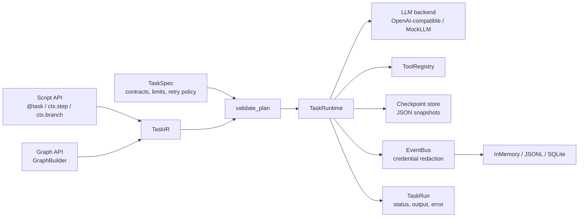

# STP Agent Framework

**A lightweight, protocol-driven execution framework for LLM agents.**

Python package: `kkk` · Version 0.2.0 · Early prototype · [Changelog](CHANGELOG.md)

[中文文档](README.zh-CN.md) · **English**

---

STP is not another prompt library. It is a small execution kernel for agent workflows:

> Describe a task as a **contract** (`TaskSpec`) plus a **plan** (`TaskIR`), then let one runtime execute it with schema validation, retries, timeouts, cancellation, and structured events.

The same plan can be authored with a declarative **script API** or an explicit **graph API**. Both compile to the same IR and are executed by the same runtime.

## Why another agent framework?

Most production failures in agent systems come from the runtime, not the prompt:

- Did the model return the shape you expected?
- What happens when a tool times out *after* it already caused a side effect?
- Is a retry safe?
- Can you replay two runs and prove they are equivalent?

STP makes these concerns explicit, testable, and observable instead of leaving them to ad-hoc `try/except` blocks.

## Features

- **Contract-first** — JSON Schema validation for task input, task output, step output, and tool input/output.
- **Two authoring frontends, one IR** — a declarative script API (`@task`, `ctx.step`, `ctx.branch`) and an explicit graph API (`GraphBuilder`). Both produce the same `TaskIR`.
- **Static plan validation** — catches dangling references, cycles, unreachable nodes, duplicate output keys on concurrently executable paths, and plans whose shortest path exceeds `max_steps` before anything runs.
- **Safe retries** — capped exponential backoff per step; non-idempotent side-effecting tools are never retried.
- **Timeout hierarchy** — task, step, and tool-level timeouts.
- **Cooperative cancellation** — `CancellationToken` checked between nodes and passed into tools.
- **Structured LLM output** — JSON Schema via `response_format`, with a `json_object` fallback and tolerant JSON extraction.
- **Event sourcing** — append-only events with a monotonic `seq`; in-memory, JSONL, and SQLite stores, with credential redaction before events reach sinks.
- **Checkpoint and resume** — persist step-boundary snapshots with `JsonCheckpointStore` and resume a failed run after validating plan/spec hashes.
- **Run equivalence** — compare two runs by status, output, retry count, and tool sequence.
- **LLM-agnostic** — works with any OpenAI-compatible endpoint (Ollama, vLLM, OpenAI, …); `MockLLM` keeps tests deterministic and offline.

## Architecture



## Installation

STP is not published on PyPI yet. Install it from source:

```bash
git clone https://github.com/AdieuJ777/SDT-Agent-Framework.git
cd SDT-Agent-Framework

# Recommended: uv
uv sync --extra dev

# Or: pip
python -m pip install -e ".[dev]"
```

Requires **Python 3.11+**.

Dependencies: `pydantic>=2.7`, `jsonschema>=4.22`, `openai>=1.40`.

## Quick start

The example below runs fully offline using `MockLLM` (for tests and examples only) and a function step:

```python
import asyncio

from kkk import MockLLM, TaskRuntime, TaskSpec, task
from kkk.script import BuildContext

spec = TaskSpec(
    task_id="TSK-EXPENSE",
    name="expense_triage",
    input_schema={
        "type": "object",
        "properties": {"text": {"type": "string"}},
        "required": ["text"],
        "additionalProperties": False,
    },
    output_schema={
        "type": "object",
        "properties": {"decision": {"type": "string"}},
        "required": ["decision"],
        "additionalProperties": False,
    },
)


@task(spec)
def build(ctx: BuildContext) -> None:
    # 1. Extract structured data with an LLM.
    ctx.step(
        "extract",
        llm=[{"role": "user", "content": ctx.input["text"]}],
        output_schema={
            "type": "object",
            "properties": {"amount": {"type": "number"}},
            "required": ["amount"],
            "additionalProperties": False,
        },
        output_key="expense",
    )

    # 2. Describe each branch at build time (nothing is executed here).
    def approve(c: BuildContext) -> None:
        c.step(
            "approve",
            func=lambda _: {"decision": "needs_approval"},
            input={},
            output_key="result",
        )

    def record(c: BuildContext) -> None:
        c.step(
            "record",
            func=lambda _: {"decision": "recorded"},
            input={},
            output_key="result",
        )

    ctx.branch(
        "route",
        condition=lambda state: (
            "approval" if state["expense"]["amount"] > 500 else "record"
        ),
        cases={"approval": approve, "record": record},
        default="record",
    )
    ctx.end({"decision": ctx.state["result"]["decision"]})


async def main() -> None:
    runtime = TaskRuntime(backend=MockLLM([{"amount": 1200}]))
    run = await build.run({"text": "flight 1200"}, runtime=runtime)
    print(run.status.value, run.output)  # SUCCEEDED {'decision': 'needs_approval'}


asyncio.run(main())
```

The same workflow can be expressed with the graph API:

```python
from kkk import GraphBuilder, GraphTask, TaskRuntime, TaskSpec
from kkk.refs import Ref

spec = TaskSpec(
    task_id="TSK-GRAPH-EXPENSE",
    name="expense_triage_graph",
    input_schema={"type": "object"},
    output_schema={
        "type": "object",
        "properties": {"decision": {"type": "string"}},
        "required": ["decision"],
        "additionalProperties": False,
    },
)

builder = GraphBuilder(spec)
classify = builder.add_step(
    "classify", func=lambda _: {"amount": 1200}, input={}, output_key="expense"
)
route = builder.add_branch(
    "route",
    condition=lambda s: "high" if s["expense"]["amount"] > 500 else "low",
    default="low",
)
high = builder.add_step(
    "high", func=lambda _: {"decision": "needs_approval"}, input={}, output_key="result"
)
low = builder.add_step(
    "low", func=lambda _: {"decision": "recorded"}, input={}, output_key="result"
)
join = builder.add_join("join")
end = builder.add_end(
    "end", {"decision": Ref("state", "result", ("decision",))}
)

builder.set_entry(classify)
builder.add_edge(classify, route)
builder.add_route(route, "high", high)
builder.add_route(route, "low", low)
builder.add_edge(high, join)
builder.add_edge(low, join)
builder.add_edge(join, end)

run = GraphTask(spec, builder).run({}, runtime=TaskRuntime())
```

## Defining a tool

A tool declares its I/O contract, side-effect semantics, and timeout:

```python
from kkk import Tool, ToolCallContext, ToolRegistry, ToolSpec


class EchoTool(Tool):
    spec = ToolSpec(
        tool_name="echo",
        description="Return the input text.",
        input_schema={
            "type": "object",
            "properties": {"text": {"type": "string"}},
            "required": ["text"],
            "additionalProperties": False,
        },
        output_schema={
            "type": "object",
            "properties": {"text": {"type": "string"}},
            "required": ["text"],
            "additionalProperties": False,
        },
        side_effect=False,
        idempotent=True,
        timeout_seconds=5.0,
    )

    async def execute(self, input_data, context: ToolCallContext):
        return {"text": input_data["text"]}


runtime = TaskRuntime(tools=ToolRegistry([EchoTool()]))
```

Use it from a plan with:

```python
ctx.step("echo", tool="echo", input={"text": ctx.input["text"]}, output_key="echoed")
```

> **Side-effect safety:** if a tool declares `side_effect=True` and `idempotent=False`, the runtime refuses to retry it and fails the run with `W_NON_IDEMPOTENT` instead of risking duplicate effects.

## Using a real model

`OpenAICompatBackend` talks to any OpenAI-compatible Chat Completions endpoint. The bundled accounting demo defaults to a local Ollama instance:

```bash
ollama serve
ollama pull qwen3:8b

uv run kkk-demo "昨天从北京飞上海，机票 1200 元，走差旅报销。"
# or: uv run python -m kkk.demo.accounting
```

The demo reads its configuration from environment variables:

```bash
export KKK_LLM_BASE_URL="http://localhost:11434/v1"
export KKK_LLM_API_KEY="ollama"
export KKK_LLM_MODEL="qwen3:8b"
export KKK_LLM_TIMEOUT="120"
```

For a hosted endpoint, point the same variables at it:

```bash
export KKK_LLM_BASE_URL="https://api.openai.com/v1"
export KKK_LLM_API_KEY="sk-..."
export KKK_LLM_MODEL="gpt-4o-mini"
```

> Environment variables are read when the backend is constructed. `.env` files are **not** loaded automatically — export the variables in your shell or load them in your application. The demo never silently falls back to `MockLLM`.

## Core concepts

| Concept | Responsibility |
| --- | --- |
| `TaskSpec` | Static contract: input/output schemas, limits, retry policy, termination condition, validators. |
| `TaskIR` | Executable plan: `step`, `branch`, `join`, and `end` nodes with edges. |
| `TaskRun` | One execution instance: status, output, error, counters, timestamps. |
| `ToolSpec` | Tool capabilities: I/O schemas, side-effect/idempotency flags, timeout, permission hints. |
| `ExecutionEvent` | Append-only event with `run_id`, monotonic `seq`, step index, attempt, payload. |
| `ExecutionContext` | Runtime view of a run: state, reference resolution, tool/LLM calls, event emission. |

## Execution semantics

- **Validation first.** Every run calls `validate_plan`. Invalid plans raise `PlanValidationError` before any tool or model is invoked.
- **DAG only.** Node kinds are `step`, `branch`, `join`, and `end`. Loops and parallel branches are not supported yet; `max_concurrency` must be `1`.
- **State and references.** Step results are written to a run-scoped state dict under `output_key`. Plans reference values with `Ref("state", key, ("field", ...))` or `ctx.state["key"]["field"]`.
- **Retries.** A step retries on retryable `FrameworkError`s up to `retry_policy.max_attempts`, with capped exponential backoff. Retries do not consume the `max_steps` budget, but each model attempt does consume `max_model_calls`.
- **Timeouts.** Step timeout defaults to 60 s, tool timeout comes from `ToolSpec.timeout_seconds` (default 30 s), and task timeout comes from `TaskSpec.timeout_seconds` (default 300 s).
- **Budgets.** `max_steps` counts both `step` and `branch` nodes at runtime. `max_steps` and `max_model_calls` are hard limits, not hints.
- **Cancellation.** Cancellation is cooperative: the runtime checks the token between nodes, and tools receive the same token through `ToolCallContext` so long-running tools can opt in.
- **Status machine.** Transitions are validated (`PENDING → RUNNING → SUCCEEDED / FAILED / CANCELLED`, with `RETRYING` and `PAUSED`); illegal transitions raise `InvalidStateTransitionError`.

## Events and run comparison

Persist events with a JSONL or SQLite sink:

```python
from kkk import JsonlEventStore, TaskRuntime

store = JsonlEventStore("runs/events.jsonl")
runtime = TaskRuntime(backend=backend, tools=registry, event_store=store)
run = await my_task.run(input_data, runtime=runtime)

for event in store.events(run.run_id):
    print(event.seq, event.event_type.value)

store.close()
```

Compare two runs without depending on node names or timestamps:

```python
from kkk.diff import compare_runs

report = compare_runs(
    run_a,
    run_b,
    left_events=runtime_a.last_events,
    right_events=runtime_b.last_events,
    strict_fields=["status"],
)
report.raise_if_different()
```

## Checkpoints and resume

Configure a checkpoint store to persist a snapshot at every successful step boundary:

```python
from kkk import JsonCheckpointStore, TaskRuntime

runtime = TaskRuntime(
    backend=backend,
    tools=registry,
    checkpoint_store=JsonCheckpointStore("checkpoints"),
)
run = await my_task.run(input_data, runtime=runtime)

# Resume from the latest checkpoint written for this run:
resumed = await runtime.resume(
    my_task.spec,
    my_task.build(),
    checkpoint_id=run.last_checkpoint_id,
)
```

Before resuming, the runtime verifies the checkpoint's task id, protocol version, plan hash, and spec hash. A checkpoint is marked unsafe when resuming could repeat a non-idempotent side effect; `resume()` then raises `E_RESUME_UNSUPPORTED` instead of guessing.

## Configuration

| Variable | Default | Description |
| --- | --- | --- |
| `KKK_LLM_BASE_URL` | `http://localhost:11434/v1` in the demo | OpenAI-compatible base URL |
| `KKK_LLM_API_KEY` | `ollama` in the demo | API key |
| `KKK_LLM_MODEL` | `qwen3:8b` in the demo | Model name |
| `KKK_LLM_TIMEOUT` | `60` in the backend, `120` in the demo | Request timeout in seconds |

If a `KKK_*` variable is unset, the backend also checks the corresponding `OPENAI_MODEL`, `OPENAI_API_KEY`, and `OPENAI_BASE_URL` variables.

## Project layout

```text
.
├── kkk/
│   ├── models.py        # TaskSpec, TaskRun, ExecutionEvent, ToolSpec
│   ├── plan.py          # TaskIR, PlanBuilder
│   ├── script.py        # declarative script API
│   ├── graph.py         # explicit graph API
│   ├── validation.py    # static plan validation
│   ├── executor.py      # TaskRuntime and graph execution
│   ├── context.py       # ExecutionContext
│   ├── tools.py         # Tool, ToolRegistry, CalculatorTool
│   ├── llm.py           # MockLLM, OpenAICompatBackend
│   ├── events.py        # EventBus
│   ├── stores.py        # InMemory / JSONL / SQLite event stores
│   ├── refs.py          # symbolic references
│   ├── schema.py        # JSON Schema helpers
│   ├── errors.py        # error taxonomy
│   ├── tokens.py        # cancellation and pause tokens
│   ├── checkpoint.py    # checkpoint snapshots and JSON store
│   ├── redaction.py     # event payload redaction
│   ├── diff.py          # run equivalence comparison
│   └── demo/
│       └── accounting.py
├── tests/
├── pyproject.toml
└── uv.lock
```

## Testing

```bash
uv sync --extra dev
uv run pytest
```

The suite covers contracts, plan validation, retries and limits, cancellation, timeouts, event stores, tool contracts, checkpoint/resume, redaction, and script-vs-graph equivalence.

## Status and limitations

STP is an **early-stage prototype** (0.2.0). The API is not stable yet. Known limitations:

- **DAG only** — no loops or parallel node execution; `max_concurrency` is fixed at `1`.
- **Single process** — `TaskRuntime` is not designed for concurrent runs; `runtime.last_events` refers to the most recent run.
- **Not a wire format yet** — `TaskIR` contains Python callables for branch conditions and function steps, so plans cannot be serialized or loaded from another process.
- **Pause is not implemented** — `PauseToken` and `TASK_PAUSED` exist, but the runtime does not pause between nodes yet. Resume from checkpoints is implemented via `TaskRuntime.checkpoint_store` and `TaskRuntime.resume()`.
- **Some declarations are reserved** — `Constraint`, `RetryPolicy.retryable_errors`, `ToolSpec.required_permissions`, `supports_cancellation`, and `allow_concurrent` are not enforced yet.
- **Synchronous callables run on the event loop** — a blocking sync function can stall the runtime and make timeouts ineffective. Prefer `async def` or wrap blocking work with `asyncio.to_thread`.
- **Idempotency keys are per call** — retries currently generate a fresh tool call id, so `context.idempotency_key` is not stable across attempts. Until deterministic retry keys land, deduplicate on a stable business key derived from your input.
- **Event redaction is best-effort** — events are redacted for common credential keys and obvious `sk-…` / `Bearer …` patterns, but this is not a substitute for keeping secrets out of prompts and state.
- **Not on PyPI** — install from source.

## Roadmap

- Deterministic idempotency keys across retries.
- Pause-token integration and checkpoint retention/cleanup.
- A serializable IR and a plan loader for cross-process execution.
- Per-run observability handles instead of `runtime.last_events`.
- A permission/plugin model for tools.
- More backends and richer retry classification.

## Contributing

Issues and pull requests are welcome. Before submitting a change:

1. Run `uv run pytest`.
2. Add or update tests for behavior changes.
3. Keep the public API documented in both `README.md` and `README.zh-CN.md`.

## License

Released under the MIT License.
