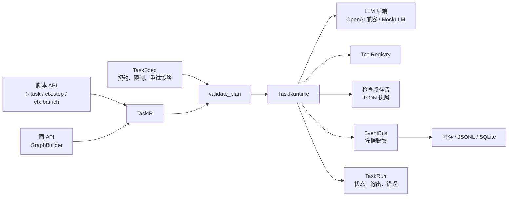

# STP Agent Framework

**一个轻量、协议驱动的 LLM Agent 执行框架。**

Python 包：`kkk` · 版本 0.2.0 · 早期原型 · [更新日志](CHANGELOG.md)

**中文** · [English](README.md)

---

STP 不是另一个 Prompt 库，而是一个很小的 Agent 工作流执行内核：

> 用一个**契约**（`TaskSpec`）描述任务，用一份**计划**（`TaskIR`）描述步骤，然后交给统一的运行时执行——自动完成 Schema 校验、重试、超时、取消和结构化事件记录。

同一份计划既可以用声明式的**脚本 API** 编写，也可以用显式的**图 API** 搭建。两种写法编译成相同的 IR，由同一个运行时执行。

## 为什么还需要一个 Agent 框架？

Agent 系统在生产环境中的大部分问题，不是 Prompt 写得不好，而是运行时没有兜住：

- 模型真的返回了预期的结构吗？
- 工具已经产生了副作用，然后超时了，怎么办？
- 这次重试安全吗？
- 能否回放两次运行并证明它们结果等价？

STP 把这些关注点显式化、可测试、可观测，而不是散落在各处的 `try/except` 里。

## 特性

- **契约优先** —— 对任务输入、任务输出、步骤输出、工具输入/输出统一做 JSON Schema 校验。
- **两种前端，一份 IR** —— 声明式脚本 API（`@task`、`ctx.step`、`ctx.branch`）与显式图 API（`GraphBuilder`）生成相同的 `TaskIR`。
- **静态计划校验** —— 执行前即可发现悬空引用、环、不可达节点、可并行路径上的重复 `output_key`，以及最短路径超过 `max_steps` 的计划。
- **安全重试** —— 每个步骤支持带上限的指数退避；声明为“有副作用且非幂等”的工具**永不重试**。
- **分层超时** —— 任务级、步骤级、工具级超时。
- **协作式取消** —— 节点间检查 `CancellationToken`，并传递给工具。
- **结构化 LLM 输出** —— 通过 `response_format` 约束 JSON Schema，并带 `json_object` 回退和宽松的 JSON 提取。
- **事件溯源** —— 严格递增 `seq` 的追加式事件；支持内存、JSONL、SQLite 三种存储，事件写入前会做凭据脱敏。
- **检查点与恢复** —— 用 `JsonCheckpointStore` 在步骤边界保存快照，并在校验计划/规格哈希后恢复失败的任务。
- **运行等价性比较** —— 按状态、输出、重试次数和工具调用序列比较两次运行。
- **LLM 无关** —— 兼容任意 OpenAI 风格接口（Ollama、vLLM、OpenAI……）；`MockLLM` 让测试保持确定性和离线。

## 架构



## 安装

STP 尚未发布到 PyPI，请从源码安装：

```bash
git clone https://github.com/AdieuJ777/SDT-Agent-Framework.git
cd SDT-Agent-Framework

# 推荐：uv
uv sync --extra dev

# 或者：pip
python -m pip install -e ".[dev]"
```

要求 **Python 3.11+**。

依赖：`pydantic>=2.7`、`jsonschema>=4.22`、`openai>=1.40`。

## 快速开始

下面的例子完全离线运行，使用 `MockLLM`（仅用于测试和示例）和一个函数步骤：

```python
import asyncio

from kkk import MockLLM, TaskRuntime, TaskSpec, task
from kkk.script import BuildContext

spec = TaskSpec(
    task_id="TSK-EXPENSE",
    name="expense_triage",
    input_schema={
        "type": "object",
        "properties": {"text": {"type": "string"}},
        "required": ["text"],
        "additionalProperties": False,
    },
    output_schema={
        "type": "object",
        "properties": {"decision": {"type": "string"}},
        "required": ["decision"],
        "additionalProperties": False,
    },
)


@task(spec)
def build(ctx: BuildContext) -> None:
    # 1. 用 LLM 抽取结构化数据。
    ctx.step(
        "extract",
        llm=[{"role": "user", "content": ctx.input["text"]}],
        output_schema={
            "type": "object",
            "properties": {"amount": {"type": "number"}},
            "required": ["amount"],
            "additionalProperties": False,
        },
        output_key="expense",
    )

    # 2. 在构建期描述每个分支（此时不会执行任何业务逻辑）。
    def approve(c: BuildContext) -> None:
        c.step(
            "approve",
            func=lambda _: {"decision": "needs_approval"},
            input={},
            output_key="result",
        )

    def record(c: BuildContext) -> None:
        c.step(
            "record",
            func=lambda _: {"decision": "recorded"},
            input={},
            output_key="result",
        )

    ctx.branch(
        "route",
        condition=lambda state: (
            "approval" if state["expense"]["amount"] > 500 else "record"
        ),
        cases={"approval": approve, "record": record},
        default="record",
    )
    ctx.end({"decision": ctx.state["result"]["decision"]})


async def main() -> None:
    runtime = TaskRuntime(backend=MockLLM([{"amount": 1200}]))
    run = await build.run({"text": "flight 1200"}, runtime=runtime)
    print(run.status.value, run.output)  # SUCCEEDED {'decision': 'needs_approval'}


asyncio.run(main())
```

同一个流程也可以用图 API 表达：

```python
from kkk import GraphBuilder, GraphTask, TaskRuntime, TaskSpec
from kkk.refs import Ref

spec = TaskSpec(
    task_id="TSK-GRAPH-EXPENSE",
    name="expense_triage_graph",
    input_schema={"type": "object"},
    output_schema={
        "type": "object",
        "properties": {"decision": {"type": "string"}},
        "required": ["decision"],
        "additionalProperties": False,
    },
)

builder = GraphBuilder(spec)
classify = builder.add_step(
    "classify", func=lambda _: {"amount": 1200}, input={}, output_key="expense"
)
route = builder.add_branch(
    "route",
    condition=lambda s: "high" if s["expense"]["amount"] > 500 else "low",
    default="low",
)
high = builder.add_step(
    "high", func=lambda _: {"decision": "needs_approval"}, input={}, output_key="result"
)
low = builder.add_step(
    "low", func=lambda _: {"decision": "recorded"}, input={}, output_key="result"
)
join = builder.add_join("join")
end = builder.add_end(
    "end", {"decision": Ref("state", "result", ("decision",))}
)

builder.set_entry(classify)
builder.add_edge(classify, route)
builder.add_route(route, "high", high)
builder.add_route(route, "low", low)
builder.add_edge(high, join)
builder.add_edge(low, join)
builder.add_edge(join, end)

run = GraphTask(spec, builder).run({}, runtime=TaskRuntime())
```

## 定义工具

工具需要声明自己的 I/O 契约、副作用语义和超时时间：

```python
from kkk import Tool, ToolCallContext, ToolRegistry, ToolSpec


class EchoTool(Tool):
    spec = ToolSpec(
        tool_name="echo",
        description="Return the input text.",
        input_schema={
            "type": "object",
            "properties": {"text": {"type": "string"}},
            "required": ["text"],
            "additionalProperties": False,
        },
        output_schema={
            "type": "object",
            "properties": {"text": {"type": "string"}},
            "required": ["text"],
            "additionalProperties": False,
        },
        side_effect=False,
        idempotent=True,
        timeout_seconds=5.0,
    )

    async def execute(self, input_data, context: ToolCallContext):
        return {"text": input_data["text"]}


runtime = TaskRuntime(tools=ToolRegistry([EchoTool()]))
```

在计划中使用它：

```python
ctx.step("echo", tool="echo", input={"text": ctx.input["text"]}, output_key="echoed")
```

> **副作用安全：** 如果工具声明了 `side_effect=True` 且 `idempotent=False`，运行时不会重试它，而是以 `W_NON_IDEMPOTENT` 失败，避免重复副作用。

## 接入真实模型

`OpenAICompatBackend` 可以连接任何 OpenAI 兼容的 Chat Completions 接口。自带的记账 Demo 默认使用本地 Ollama：

```bash
ollama serve
ollama pull qwen3:8b

uv run kkk-demo "昨天从北京飞上海，机票 1200 元，走差旅报销。"
# 或者：uv run python -m kkk.demo.accounting
```

Demo 从环境变量读取配置：

```bash
export KKK_LLM_BASE_URL="http://localhost:11434/v1"
export KKK_LLM_API_KEY="ollama"
export KKK_LLM_MODEL="qwen3:8b"
export KKK_LLM_TIMEOUT="120"
```

使用托管服务时，把同一组变量指向对应地址即可：

```bash
export KKK_LLM_BASE_URL="https://api.openai.com/v1"
export KKK_LLM_API_KEY="sk-..."
export KKK_LLM_MODEL="gpt-4o-mini"
```

> 环境变量在后端构造时读取。`.env` 文件**不会**被自动加载——请在 shell 中 export，或在应用里自行加载。Demo 不会静默回退到 `MockLLM`。

## 核心概念

| 概念 | 职责 |
| --- | --- |
| `TaskSpec` | 静态契约：输入/输出 Schema、限制、重试策略、终止条件、业务校验器。 |
| `TaskIR` | 可执行计划：由 `step`、`branch`、`join`、`end` 节点和边组成。 |
| `TaskRun` | 一次执行实例：状态、输出、错误、计数器、时间戳。 |
| `ToolSpec` | 工具能力：I/O Schema、副作用/幂等标记、超时、权限提示。 |
| `ExecutionEvent` | 追加式事件：`run_id`、严格递增 `seq`、步骤索引、尝试次数、payload。 |
| `ExecutionContext` | 运行期视图：状态、引用解析、工具/LLM 调用、事件发送。 |

## 执行语义

- **先校验，后执行。** 每次运行都会调用 `validate_plan`；非法计划在调用任何工具或模型之前抛出 `PlanValidationError`。
- **只支持 DAG。** 节点类型为 `step`、`branch`、`join`、`end`；暂不支持循环和并行分支，`max_concurrency` 必须为 `1`。
- **状态与引用。** 步骤结果会写入以 `output_key` 为键的运行期状态；计划通过 `Ref("state", key, ("field", ...))` 或 `ctx.state["key"]["field"]` 引用这些值。
- **重试。** 步骤遇到可重试的 `FrameworkError` 时，最多重试 `retry_policy.max_attempts` 次，使用带上限的指数退避。重试不计入 `max_steps`，但每次模型尝试都会消耗 `max_model_calls`。
- **超时。** 步骤超时默认 60 秒；工具超时来自 `ToolSpec.timeout_seconds`（默认 30 秒）；任务超时来自 `TaskSpec.timeout_seconds`（默认 300 秒）。
- **预算。** 运行时把 `step` 和 `branch` 节点都计入 `max_steps`。`max_steps` 和 `max_model_calls` 是硬限制，不是建议值。
- **取消。** 取消是协作式的：运行时在节点之间检查 token，并通过 `ToolCallContext` 把同一个 token 传给工具，长耗时工具可以自行响应。
- **状态机。** 状态转换会被校验（`PENDING → RUNNING → SUCCEEDED / FAILED / CANCELLED`，以及 `RETRYING` 和 `PAUSED`）；非法转换抛出 `InvalidStateTransitionError`。

## 事件与运行比较

使用 JSONL 或 SQLite 存储事件：

```python
from kkk import JsonlEventStore, TaskRuntime

store = JsonlEventStore("runs/events.jsonl")
runtime = TaskRuntime(backend=backend, tools=registry, event_store=store)
run = await my_task.run(input_data, runtime=runtime)

for event in store.events(run.run_id):
    print(event.seq, event.event_type.value)

store.close()
```

比较两次运行，且不依赖节点名称或时间戳：

```python
from kkk.diff import compare_runs

report = compare_runs(
    run_a,
    run_b,
    left_events=runtime_a.last_events,
    right_events=runtime_b.last_events,
    strict_fields=["status"],
)
report.raise_if_different()
```

## 检查点与恢复

配置检查点存储后，每个步骤成功结束时都会保存一份快照：

```python
from kkk import JsonCheckpointStore, TaskRuntime

runtime = TaskRuntime(
    backend=backend,
    tools=registry,
    checkpoint_store=JsonCheckpointStore("checkpoints"),
)
run = await my_task.run(input_data, runtime=runtime)

# 从该 run 最近一次检查点恢复：
resumed = await runtime.resume(
    my_task.spec,
    my_task.build(),
    checkpoint_id=run.last_checkpoint_id,
)
```

恢复前，运行时会校验检查点的 task id、协议版本、计划哈希和规格哈希。如果恢复可能重复执行非幂等的副作用，检查点会被标记为不安全，`resume()` 会抛出 `E_RESUME_UNSUPPORTED`，而不是盲目重放。

## 配置

| 环境变量 | 默认值 | 说明 |
| --- | --- | --- |
| `KKK_LLM_BASE_URL` | Demo 中为 `http://localhost:11434/v1` | OpenAI 兼容接口地址 |
| `KKK_LLM_API_KEY` | Demo 中为 `ollama` | API Key |
| `KKK_LLM_MODEL` | Demo 中为 `qwen3:8b` | 模型名称 |
| `KKK_LLM_TIMEOUT` | 后端为 `60`，Demo 为 `120` | 请求超时（秒） |

如果未设置对应的 `KKK_*` 变量，后端还会依次检查 `OPENAI_MODEL`、`OPENAI_API_KEY` 和 `OPENAI_BASE_URL`。

## 项目结构

```text
.
├── kkk/
│   ├── models.py        # TaskSpec、TaskRun、ExecutionEvent、ToolSpec
│   ├── plan.py          # TaskIR、PlanBuilder
│   ├── script.py        # 声明式脚本 API
│   ├── graph.py         # 显式图 API
│   ├── validation.py    # 静态计划校验
│   ├── executor.py      # TaskRuntime 与图执行
│   ├── context.py       # ExecutionContext
│   ├── tools.py         # Tool、ToolRegistry、CalculatorTool
│   ├── llm.py           # MockLLM、OpenAICompatBackend
│   ├── events.py        # EventBus
│   ├── stores.py        # 内存 / JSONL / SQLite 事件存储
│   ├── refs.py          # 符号引用
│   ├── schema.py        # JSON Schema 工具函数
│   ├── errors.py        # 错误体系
│   ├── tokens.py        # 取消与暂停 token
│   ├── checkpoint.py    # 检查点快照与 JSON 存储
│   ├── redaction.py     # 事件载荷脱敏
│   ├── diff.py          # 运行等价性比较
│   └── demo/
│       └── accounting.py
├── tests/
├── pyproject.toml
└── uv.lock
```

## 测试

```bash
uv sync --extra dev
uv run pytest
```

测试覆盖契约校验、计划校验、重试与限制、取消、超时、事件存储、工具契约、检查点与恢复、脱敏，以及脚本 API 与图 API 的等价性。

## 项目状态与限制

STP 目前是**早期原型**（0.2.0），API 尚不稳定。已知限制：

- **仅支持 DAG** —— 不支持循环和并行节点；`max_concurrency` 固定为 `1`。
- **单进程** —— `TaskRuntime` 不是为并发运行设计的；`runtime.last_events` 只指向最近一次运行。
- **尚不是可传输格式** —— `TaskIR` 中的分支条件和函数步骤是 Python callable，因此计划无法序列化，也无法从其他进程加载。
- **暂停尚未实现** —— `PauseToken` 和 `TASK_PAUSED` 已存在，但运行时还不会在节点间暂停。检查点恢复已通过 `TaskRuntime.checkpoint_store` 和 `TaskRuntime.resume()` 实现。
- **部分声明是保留字段** —— `Constraint`、`RetryPolicy.retryable_errors`、`ToolSpec.required_permissions`、`supports_cancellation`、`allow_concurrent` 尚未生效。
- **同步函数会运行在事件循环上** —— 阻塞的同步函数会卡住运行时，使超时失效。请优先使用 `async def`，或用 `asyncio.to_thread` 包装阻塞逻辑。
- **幂等键按调用生成** —— 重试目前会生成新的工具调用 id，因此 `context.idempotency_key` 在不同尝试间并不稳定。在确定性重试键实现之前，请使用基于输入的业务主键去重。
- **事件脱敏是尽力而为** —— 常见凭据字段、明显的 `sk-…` / `Bearer …` 文本会被替换，但这不能替代“不要把密钥放进 Prompt 或状态”的纪律。
- **尚未发布到 PyPI** —— 请从源码安装。

## 路线图

- 跨重试稳定的确定性幂等键。
- 暂停 token 接入，以及检查点的保留与清理策略。
- 可序列化 IR 与计划加载器，支持跨进程执行。
- 用每次运行独立的观测句柄替代 `runtime.last_events`。
- 工具权限与插件模型。
- 更多后端与更细粒度的重试分类。

## 贡献

欢迎提交 Issue 和 Pull Request。提交变更前请：

1. 运行 `uv run pytest`。
2. 为行为变更补充或更新测试。
3. 同步更新 `README.md` 与 `README.zh-CN.md`。

## 许可证

基于 MIT License 开源。
