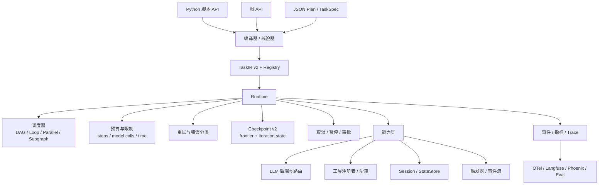

# STP：双模式结构化智能体编排框架路线图

> 基线版本：0.2.0（规划基线；当前 `kkk/pyproject.toml` 仍为 0.1.0，发布前需对齐）  
> 文档状态：架构决策 + 路线图 + 验收标准（Draft）  
> 最后更新：2026-10-29  
> 关联文档：[README](README.md) · [CHANGELOG](CHANGELOG.md)（待补） · [PROJECT_CHARTER](PROJECT_CHARTER.md)
>
> **论文主线**：面向结构化任务协议的双模式统一执行与行为等价；  
> durable / auditable 能力是支撑双模式承诺的运行时基础，不是替代双模式的定位。

---

## 0. 一页结论

STP 的目标不是做一个“功能最多的 Agent 框架”，而是做一个**面向结构化任务协议的双模式智能体编排框架**：

- 脚本 API 和图 API 共享同一份 TaskIR 与执行语义；
- 由同一个可恢复、可审计的运行时执行；
- durable execution 是支撑双模式承诺的基础设施，而不是替代双模式的定位。

可以把它理解为“带双作者模式的 LLM Temporal”，但 **dual-mode 是身份，durable 是基础**。

要达到“完整框架”，需要同时完成三件事：

1. **语义闭环**：双模式共享同一 IR/运行时、计划可序列化、执行可恢复、副作用有一致性语义、公共 API 不再有“声明了但没实现”的字段。
2. **能力扩展**：循环、并行、子图、会话状态、动态工具调用、人在回路；**每个能力都必须同时支持脚本与图两种前端，或有明确的单模式 experimental 标记**。
3. **生产化**：权限与沙箱、OpenTelemetry 与评估、MCP/OpenAPI 集成、PyPI 与版本治理。

推荐路线：

```text
0.3.0 可信执行（修正确性与安全债务）
  ↓
0.4.0 可移植协议（可序列化 IR + 注册表 + 跨进程）
  ↓
0.5.0 持久控制流（checkpoint v2 + 循环/并行/子图 + 会话）
  ↓
0.6.0 动态能力（AgentStep + tool calling + 模型层）
  ↓
0.7.0 治理能力（权限/沙箱/审批/暂停）
  ↓
0.8.0 可观测与评估（OTel + eval harness）
  ↓
0.9.0 互操作（MCP / OpenAPI / 插件）
  ↓
1.0.0 稳定版（API 冻结、迁移策略、基准与文档）
```

**最重要的判断：不要跳过 0.3.0。** 当前代码里还有幂等键不稳定、同步调用阻塞事件循环、checkpoint 安全（SecretRef/加密/访问控制）等问题；在这些问题解决之前增加循环/并行，只会把错误放大。

同时，0.3.0 必须做一次**双模式 parity 审计**：哪些能力脚本有、图没有，哪些只有图有、脚本没有，哪些只是“概念上支持”但没有差分测试。这个清单比新增节点类型更重要。

---

## 1. 目标与非目标

### 1.1 v1.0 的目标

一个可以交给外部团队使用的**双模式结构化编排框架 + 可恢复运行时**，满足：

- 脚本 API 和图 API 生成同一份 TaskIR，由同一运行时执行；每个新能力必须双端可用，或明确标记为单模式 experimental。
- 计划可以存盘、版本化、跨进程加载和执行。
- 任务可以在失败、取消、进程重启后安全恢复。
- 副作用工具在重试和恢复下不会重复执行（在声明幂等的前提下）。
- 支持顺序、分支、循环、并行、子图和子任务复用。
- 支持跨 run 的会话状态和类型化状态存储。
- 工具权限、沙箱、审批和暂停真正生效。
- 事件、指标、trace 和评估可以接入外部系统。
- 公共 API 中不存在“声明了但运行时不生效”的能力。

### 1.2 v1.0 的非目标

以下能力不应进入核心内核，最多作为插件或上层应用：

- 多 Agent 委派与群体协作。
- 向量数据库、长期记忆服务。
- Web UI、可视化编排器（可以作为独立工具）。
- 模型训练、微调、推理服务部署。
- 通用 RAG 平台。
- 包办所有模型厂商的 SDK。

### 1.3 必须守住的差异化

无论怎么演进，以下设计不能为了“通用”而丢掉：

- **双模式同源**：脚本和图生成同一 TaskIR，由同一运行时执行；新增能力必须双端可用，并有差分测试。
- 契约优先（JSON Schema 校验输入、输出、工具 I/O）。
- 执行前静态计划校验。
- 事件溯源与严格递增 `seq`。
- checkpoint 恢复安全判断（副作用、UNKNOWN 工具调用）。
- 运行等价性比较（`compare_runs`）。
- 内核小、集成走插件。

---

## 2. 当前基线（0.2.0）

### 2.1 能力矩阵

| 能力 | 状态 | 说明 |
| --- | --- | --- |
| 任务契约 | ✅ | 输入/输出/步骤/工具的 JSON Schema 校验 |
| 脚本/图双模式统一 IR | ✅ | 两种 API 生成同一 TaskIR，由同一运行时执行 |
| 双模式行为等价测试 | ✅ | `compare_runs` + 线性/分支/恢复等价测试；复杂控制流仍需扩展 |
| 静态计划校验 | 🟡 | 缺 end 输出引用、数据流顺序、工具注册表校验；`max_steps` 口径不一致 |
| DAG 执行 | ✅ | `step` / `branch` / `join` / `end`，单令牌顺序执行 |
| 重试与退避 | 🟡 | 可用，但幂等键跨尝试不稳定；`retryable_errors` 未生效 |
| 超时 | 🟡 | 只对 async 有效；同步 callable 会阻塞事件循环 |
| 取消 | 🟡 | 节点边界协作式检查；不能中断在途 LLM 请求 |
| 检查点/恢复 | 🟡 | 分支/汇合恢复、路径一致性、随机 DAG 测试已具备；仍无 checkpoint 安全（SecretRef/加密）、保留策略、`code_revision` |
| 事件脱敏 | 🟡 | 只覆盖事件 payload；checkpoint 仍保存原始输入/状态 |
| 事件与存储 | ✅ | 内存 / JSONL / SQLite；有 `event_schema_version`、耗时字段 |
| 多 run 并发 | ❌ | `TaskRuntime.last_bus` 是共享状态，单 runtime 只保留最近一次 |
| 会话/跨 run 状态 | ❌ | 只有 per-run state |
| 原生 tool calling | ❌ | 工具顺序在构建期写死 |
| 流式输出 | ❌ | 只有一次性 chat |
| 权限/沙箱 | ❌ | `required_permissions` 等字段声明但未执行 |
| 暂停/人在回路 | ❌ | `PauseToken` / `PAUSED` 尚未接线 |
| 评估框架 | ❌ | 只有 `compare_runs` |
| MCP / OpenAPI | ❌ | 无 |
| 打包与治理 | 🟡 | 当前 `pyproject` 为 0.1.0；MIT/CI/CHANGELOG 待补；未上 PyPI；包名仍为 `kkk` |

图例：✅ 完成 / 🟡 部分完成 / ❌ 缺失。

### 2.2 当前需要优先处理的债务

| 问题 | 位置 | 影响 |
| --- | --- | --- |
| 幂等键每次调用重新生成 | `kkk/context.py:467-473` | 重试/resume 无法按幂等键去重，可能重复副作用 |
| 同步 callable 直接在事件循环执行 | `kkk/context.py:551`、`kkk/tools.py:55` | 阻塞整个运行时，超时失效 |
| checkpoint 保存原始 input/state | `kkk/executor.py:461-495`、`kkk/checkpoint.py:78-79` | API Key、PII 可能落盘 |
| checkpoint 无保留策略 | `kkk/checkpoint.py` | 每步一个文件，长期运行无限增长 |
| end 的 `output_mapping` 引用未校验 | `kkk/validation.py:222` | 写错引用只能运行时发现 |
| `max_steps` 静态/运行时口径不一致 | `kkk/validation.py:82`、`kkk/executor.py:1053` | 通过静态校验的计划仍可能运行时超限 |
| resume 不感知代码实现变化 | `kkk/checkpoint.py:44-50` | 改函数实现后可能用新代码跑旧状态 |
| `runtime.last_events` 是共享状态 | `kkk/executor.py:75-79` | 并发 run 会互相覆盖 |
| `required_permissions` / `retryable_errors` / `allow_concurrent` | `kkk/models.py` | 声明未生效，用户会误以为有保护 |
| 所有 HTTP 400 都被当作 json_schema 不支持 | `kkk/llm.py` 的 `_is_unsupported_response_format` | 掩盖真正的请求/schema 错误 |

---

## 3. 关键架构决策

以下决策建议在 0.4.0 之前定稿，并写入 `docs/adr/`。

### ADR-000：双模式编排是核心产品面

**决策**：脚本 API 与图 API 是一等公民。所有新增控制流和能力必须同时设计两种前端，或明确标记为单模式 experimental；差分测试是发布门槛。

**理由**：这是项目最初的课题与最重要的差异化。如果只保留图模式，或只保留 durable runtime，项目会退化成通用工作流平台，失去“双模式统一语义”的独特价值。

**结果**：
- 新能力（Loop / Map / Subgraph / AgentStep 等）必须同时设计脚本与图两种表达。
- 不允许在 IR/运行时实现后长期缺一个前端。
- 每个控制流能力必须有脚本/图差分测试，否则不算完成。
- 双模式不一致时优先修语义，不在文档里解释差异。

### ADR-001：定位为“双模式结构化编排 + 持久化可审计运行时”，而不是通用 Agent 框架

**决策**：核心负责结构化任务协议、双模式编排和可靠执行；动态工具调用、会话、记忆、多 Agent 作为可选层。

**理由**：现有优势（双模式统一 IR、契约、静态校验、事件、checkpoint、等价性）都指向“可靠、可验证的编排”，而不是“自主智能”。与通用 Agent 框架比功能数量没有胜算，比双模式统一语义、可靠性、可复现性、可审计性才有。

**结果**：
- 新增 `AgentStep` 作为可选节点，而不是把 ReAct 循环塞进每个 step；它也必须双端可用。
- 会话、记忆、触发器、MCP 都通过接口/插件接入。
- 非目标能力不进入核心依赖。

### ADR-002：IR 与 TaskSpec 必须可序列化

**决策**：引入 IR v2。计划中的分支条件、函数步骤、业务校验器都改为“命名引用 + 注册表”，不再直接保存 Python callable。

可选方案：
1. **命名函数引用**（推荐）：`{"kind": "ref", "name": "billing.compute_total", "version": "1"}`。
2. **受限表达式语言**：用于简单条件，例如 `state.expense.amount > 500`。不建议允许任意 Python 代码。

**理由**：只有可序列化，计划才能存盘、跨进程、作为产品资产分发、做版本对比和安全审查。

**结果**：
- `TaskIR` 增加 `schema_version`。
- `TaskSpec` 的 `validators` 也需要注册表引用。
- 提供 loader、validator CLI 和版本迁移机制。
- `plan_hash` 必须能感知实现版本，或引入显式 `code_revision`。

### ADR-003：持久执行的一致性语义

**决策**：默认采用 **at-least-once + 幂等契约**，不承诺无条件 exactly-once。

- 幂等键必须由 `run_id + node_id + step_index`（或逻辑调用 ID）确定，跨尝试稳定。
- 声明 `side_effect=True, idempotent=False` 的工具，在恢复安全性无法证明时拒绝自动 resume。
- 需要 exactly-once 的外部副作用，由工具侧实现幂等，或后续引入 outbox / saga / 补偿动作。

**结果**：
- 修复当前幂等键生成逻辑。
- checkpoint 与事件中记录足够的调用证据（call id、幂等键、工具版本）。
- 恢复策略分为 `safe`（默认）和 `fast`（明确接受重复风险）。

### ADR-004：信任边界与安全模型

**决策**：明确计划作者、工具作者、运行环境三者是否可信。

需要回答：
- 计划是可信开发者编写，还是外部用户提交？
- 工具是本地可信代码，还是第三方插件？
- checkpoint 是否只在本地使用，还是会在机器之间共享？

**结果**：
- 不可信计划必须使用受限表达式和沙箱。
- 工具权限、秘密引用、输出 taint 标记必须可执行，而不只是声明。
- checkpoint 需要脱敏；共享场景需要 HMAC/加密。

### ADR-005：内核小、集成走插件

**决策**：核心只保留契约、计划、执行器、事件、checkpoint、状态接口。模型厂商、MCP、OpenAPI、向量库、数据库全部做插件。

**结果**：
- 核心依赖保持 `pydantic`、`jsonschema` 和最小网络抽象。
- 插件通过 entry points 或显式注册表加载。
- 不为单个场景（例如 CS2）往内核里加业务语义。

---

## 4. 目标架构



图中脚本与图 API 必须汇聚到同一 IR；任何绕过 IR 的模式专属执行路径都是设计错误。

### 4.1 核心不变量

0. **双模式同源**：脚本与图生成同一 TaskIR，经同一 Runtime 执行；新增能力必须双端可用，差分测试通过。
1. **契约先于执行**：输入、输出、工具 I/O、计划结构都在执行前校验。
2. **计划可重放**：同样的输入、计划、代码版本和模型响应，产生同样的业务结果。
3. **事件只追加**：每次 run 内 `seq` 严格递增；事件 schema 带版本。
4. **检查点原子**：临时文件 + fsync + 原子替换；损坏必须显式报错。
5. **副作用可判断**：每个工具声明副作用与幂等性；恢复前必须能判断是否安全。
6. **预算硬约束**：`max_steps`、`max_model_calls`、任务/步骤/工具超时都是硬限制。
7. **公共 API 不说谎**：声明了的字段必须生效，否则从公开 API 移除或标记 experimental。
8. **内核不绑定场景**：业务语义通过工具、节点和插件表达，不进入核心。

### 4.2 数据模型演进

| 模型 | 0.2.0 | 目标 |
| --- | --- | --- |
| `TaskSpec` | 含 callable validators | `schema_version`、命名 validator 引用、`code_revision`、显式能力开关 |
| `TaskIR` | callable condition/function | JSON 可序列化、`schema_version`、迁移、plan registry |
| `TaskRun` | 单次执行 | 增加 `parent_run_id`、`session_id`、`code_revision`、`trace_id` |
| `Checkpoint` | 线性 `completed_steps` + `next_step_id` | `frontier`、`completed_nodes`、`iteration_state`、`inner_loop_state`、`state_version` |
| `ExecutionEvent` | 基础事件 | `trace_id` / `span_id`、统一 token/cost 字段、可导出 OTel |
| `ToolSpec` | 含未执行字段 | 权限模型、版本、沙箱需求、秘密引用、能力声明 |
| 新增 `Session` | 无 | 跨 run 状态、版本、CAS 更新 |
| 新增 `Trigger` | 无 | 事件订阅、定时器、去抖、单飞、过期丢弃 |

### 4.3 目标 IR 示例

```json
{
  "schema_version": "2.0",
  "task_id": "TSK-EXPENSE",
  "entry": "extract",
  "nodes": {
    "extract": {
      "kind": "step",
      "action": {
        "kind": "llm",
        "prompt_ref": "expense.extract@1",
        "output_schema_ref": "expense.v1"
      },
      "output_key": "expense",
      "next": "route"
    },
    "route": {
      "kind": "branch",
      "condition": {
        "kind": "expr",
        "expr": "state.expense.amount > 500"
      },
      "routes": { "true": "approve", "false": "record" },
      "default": "false"
    },
    "approve": {
      "kind": "step",
      "action": { "kind": "tool", "tool_ref": "request_approval@1" },
      "output_key": "result",
      "next": "join"
    },
    "record": {
      "kind": "step",
      "action": { "kind": "tool", "tool_ref": "record_expense@1" },
      "output_key": "result",
      "next": "join"
    },
    "join": { "kind": "join", "next": "end" },
    "end": {
      "kind": "end",
      "output_mapping": {
        "status": { "ref": "state.result.status" }
      }
    }
  }
}
```

---

## 5. 工作流（Workstreams）

每个工作流都应独立可验收，避免“大爆炸式重构”。

### W1 — 可信执行硬化（0.3.0）

**目标**：让 0.2.0 已有能力真正可信。

**交付物**：

1. 稳定幂等键：`run_id + node_id + step_index`，重试不变化。
2. 同步 callable 走 `asyncio.to_thread`，并明确“超时不能杀死线程”的边界。
3. checkpoint 安全 + 保留策略：SecretRef / 加密 / 访问控制；不要对恢复所需的 state 做单向 redaction；每个 run 保留最近 N 份 / TTL。
4. 静态校验补全：end 输出引用、数据流顺序、工具注册表、统一 `max_steps` 口径。
5. resume 代码版本指纹：显式 `code_revision`，写入 checkpoint 并校验。
6. 每次 run 独立观测句柄，逐步淘汰 `runtime.last_events`。
7. 双模式 parity 审计：列出脚本/图两端的能力覆盖差异，补齐测试或明确标记 experimental。

**验收标准**：

- 每个现有能力在脚本/图两端都有覆盖清单；差异要么修复，要么标记。
- 同一步骤重试两次，工具收到同一个幂等键。
- 同步阻塞函数执行期间，其他协程仍能推进。
- checkpoint 中不出现明文秘密；敏感字段通过 SecretRef / 加密 / 访问控制处理，并且仍能正确恢复。
- 错误引用在 `validate_plan` 阶段失败，而不是运行时抛 `E_FRAMEWORK`。
- 改变 `code_revision` 后 resume 被明确拒绝。
- 并发两个 run 时，各自的事件互不覆盖。

### W2 — 可移植协议（0.4.0）

**目标**：从“进程内库”变成“可分发协议”。

**交付物**：

- IR v2 JSON Schema + `TaskSpec` v2 JSON Schema。
- 函数/条件/校验器注册表与版本锁定。
- `stp validate` / `stp run --plan plan.json` CLI。
- plan loader、迁移器、兼容性测试。
- 跨进程 worker 原型：主进程提交计划，worker 执行并回传事件。
- **脚本/图前端必须继续生成同一 IR；JSON plan 是第三种入口，不是替代双模式。**

**验收标准**：

- 同一份 plan JSON 可以在两个独立进程中加载并执行。
- 注册表缺失、版本不匹配、schema 非法都给出明确错误。
- 旧版本计划可以通过迁移器升级。
- 脚本 API 和图 API 生成的计划仍可通过同一 loader/validator 校验，并通过差分测试。

### W3 — 持久控制流（0.5.0）

**目标**：支持真实工作流需要的控制流，并保持可恢复。

**交付物**：

- Checkpoint v2：`frontier` / pending set / iteration counters / inner-loop state。
- `Loop` 节点：最大迭代、终止条件、迭代超时。
- `Map` / fan-out：对列表逐项处理，明确并发上限。
- `Subgraph` / 子任务调用：独立 run_id、父 run 关联、状态隔离。
- Join 语义：`all` / `any` / `first`。
- 多 run 并发与取消传播。
- **所有新控制流同时暴露于脚本 API 和图 API，并有差分测试。**

**验收标准**：

- 并行分支在任意步骤失败后可以恢复，不重复已完成节点。
- 循环任务在重启后从正确迭代继续。
- 子图失败可以向上传播，也可以被父计划捕获。
- 并发 run 的事件、checkpoint、取消互不干扰。
- 每个新控制流在脚本/图两端都能表达，且恢复后的关键行为等价。

**前置条件**：W1 完成；checkpoint v2 先于并行实现。

### W4 — 会话与状态（0.5.0–0.6.0）

**目标**：支持跨 run 的业务状态。

**交付物**：

- `Session` / `Thread` 概念：`session_id`、版本、元数据。
- `StateStore` 协议：内存 / SQLite / Redis / Postgres 实现。
- 类型化 state（Pydantic 模型）与 schema 版本迁移。
- CAS（compare-and-swap）更新，避免并发覆盖。
- 可选：短期/长期记忆接口，但不在核心实现。

**验收标准**：

- 同一 session 的连续 run 能读写同一份状态。
- 并发更新通过版本号或 CAS 检测冲突。
- 状态 schema 升级有迁移路径。

### W5 — 动态能力（0.6.0）

**目标**：在不破坏预算与审计的前提下支持模型自主决策。

**交付物**：

- `AgentStep`：内部执行 `LLM → tool calls → tool results → LLM` 循环。
- **`AgentStep` 必须同时支持脚本声明和图节点两种接入方式，并有差分测试。**
- 工具调用预算、最大迭代、停止条件、超时。
- 流式事件与部分输出。
- 模型能力描述：tool calling、json_schema、streaming、vision、上下文窗口、成本。
- 模型路由/降级、prompt/response 缓存、record & replay。
- prompt 注册与版本管理。

**验收标准**：

- `AgentStep` 内部循环受 `max_steps` / `max_model_calls` / timeout 约束。
- 恢复点落在 `AgentStep` 内部时，内部消息与工具结果可恢复，不重复副作用。
- record & replay 能在离线环境重现同一结果。
- `AgentStep` 在脚本/图两种接入方式下的关键行为等价。

### W6 — 安全、权限与人在回路（0.6.0–0.7.0）

**目标**：让“声明”变成“执行”。

**交付物**：

- 强制 `required_permissions`：网络、文件、进程、外部 API 白名单。
- 工具沙箱接口：进程内 / 子进程 / 容器。
- 秘密引用：`SecretRef("env:OPENAI_API_KEY")`，运行时解析，事件与 checkpoint 脱敏。
- 不可信输入标记（taint）：工具输出、检索内容默认不可信，Prompt 构建时可强制隔离。
- 审批节点 / `wait` 节点：暂停、等待外部信号、从 checkpoint 恢复。
- 真正接线 `PauseToken` 与 `PAUSED` 状态。

**验收标准**：

- 未授权工具调用在执行前被拒绝。
- 审批任务可以暂停数小时/数天后安全恢复。
- 事件、checkpoint、日志中不出现秘密明文。

### W7 — 可观测与评估（0.7.0）

**交付物**：

- OpenTelemetry trace/span：run → step → LLM/tool。
- 指标：run 数、延迟分位数、重试率、token、成本、checkpoint 大小、resume 成功率。
- Langfuse / Phoenix 等导出适配器。
- 评估框架：数据集、批量运行、打分器、回归对比、CI gate。
- prompt/response 查看器接口。

**验收标准**：

- 一次 run 可以在 OTel 中看到完整 span 树。
- 同一数据集两次运行可以生成可比较的评估报告。
- 评估回归能阻止 CI 合并。

### W8 — 互操作与生态（0.8.0–0.9.0）

**交付物**：

- MCP 客户端：连接外部工具服务器，映射为 `Tool` + 权限声明。
- MCP 服务端（可选）：把 STP 任务暴露为工具。
- OpenAPI 导入：生成工具描述与 schema。
- JSON Schema `$ref` / union / nullable 的完整解析策略。
- 插件注册表与版本清单。

**原则**：全部作为插件，不进入核心依赖。

### W9 — 发布与治理（持续）

**交付物**：

- PyPI 发布（建议先解决包名 `kkk`）。
- 语义化版本、弃用策略、迁移指南。
- `py.typed`、类型检查、lint、覆盖率门槛。
- `SECURITY.md`、`CONTRIBUTING.md`、issue/PR 模板。
- 基准测试与性能预算。
- 文档站或至少 `docs/` 目录。

---

## 6. 版本计划

| 版本 | 主题 | 关键交付 | 退出标准 |
| --- | --- | --- | --- |
| 0.3.0 | 可信执行 | 幂等键、同步 offload、checkpoint 安全/保留、静态校验、代码版本、per-run handle、双模式 parity 审计 | 现有能力在重试/恢复下可证明安全，脚本/图差异有清单 |
| 0.4.0 | 可移植协议 | IR v2、注册表、loader、CLI、跨进程 worker；脚本/图前端继续生成同一 IR | 计划可存盘、可加载、可跨进程执行；双模式仍等价 |
| 0.5.0 | 持久控制流 | checkpoint v2、Loop/Map/Subgraph、多 run、Session/StateStore；新控制流双前端 | 循环/并行可恢复，状态跨 run，脚本/图行为等价 |
| 0.6.0 | 动态能力 | AgentStep、tool calling、streaming、模型路由、缓存、record/replay；AgentStep 双前端 | 模型可自主选工具且预算/审计不破，双模式可用 |
| 0.7.0 | 治理能力 | 权限、沙箱、秘密引用、taint、审批/暂停 | 未授权操作被拒绝，审批可恢复 |
| 0.8.0 | 可观测与评估 | OTel、指标、eval harness、导出器 | 可接入外部观测/评估体系 |
| 0.9.0 | 互操作 | MCP 客户端、OpenAPI、插件注册表 | 外部工具生态可接入 |
| 1.0.0 | 稳定版 | API 冻结、迁移策略、文档、基准、安全政策 | 满足第 8 节全部退出标准 |

> 时间是相对估算，取决于投入人数；建议以“退出标准”而不是日期作为发布依据。

---

## 7. 横切工程要求

### 7.1 测试策略

- 单元测试：模型、校验、执行器、存储。
- **双模式差分测试：每个控制流/新增能力在脚本和图两端执行，比较关键输出、状态、错误码、重试次数和工具调用行为；作为发布门槛。**
- 属性测试：图校验、checkpoint 往返、事件序列不变量（建议引入 Hypothesis）。
- 故障注入：sink 失败、checkpoint 损坏、工具超时、进程在步骤中断。
- 回放测试：录制 LLM 响应，离线重放。
- 集成测试：Ollama / OpenAI 兼容接口 / MCP 服务器。
- 基准测试：调度开销、checkpoint 写入、事件吞吐、恢复时间。
- 覆盖率目标：核心模块 85% 以上；关键安全路径接近 100%。

### 7.2 兼容性策略

- 四个独立版本号：`protocol_version`、IR `schema_version`、event `event_schema_version`、`checkpoint_version`。
- 至少支持 N-1 版本的读取；写入总是最新版本。
- 弃用流程：minor 版本警告，下一个 major 移除。
- 计划、事件、checkpoint 都提供迁移器与兼容性测试。

### 7.3 性能预算（建议目标）

| 指标 | 目标 |
| --- | --- |
| 运行时调度开销（不含 LLM/工具） | p95 < 10 ms |
| 单次 checkpoint 写入（100 KB 状态，SSD） | p95 < 20 ms，可异步化 |
| 事件写入开销 | p95 < 5 ms/事件，支持批量 |
| resume 时间 | 与状态大小线性，1 MB 状态 < 200 ms |
| 并发 run | 单进程至少 100 个轻量 run |

### 7.4 安全基线

- 默认拒绝：工具权限白名单、网络/文件访问显式授权。
- 秘密不进入事件、checkpoint、日志；必要时加密。
- checkpoint 与计划文件明确信任边界；共享场景加 HMAC/签名。
- 不可信输入（工具输出、检索内容）默认标记，Prompt 层强制隔离。
- 依赖锁定、漏洞扫描、最小依赖。

### 7.5 文档要求

每个公共能力至少包含：

- 概念说明与适用场景。
- 最小可运行示例。
- 失败模式与恢复方式。
- 与现有 API 的兼容性说明。
- 中英文 README 同步。

---

## 8. v1.0 退出标准

只有全部满足，才建议发布 1.0.0：

- [ ] 脚本/图双模式在 DAG/Loop/Map/Subgraph/AgentStep 上均可表达，并通过差分测试；不允许核心能力只有单模式实现。
- [ ] 计划与 TaskSpec 完全可序列化，提供 schema、loader、迁移器和跨进程 worker。
- [ ] DAG / Loop / Map / Subgraph 均可在失败后安全恢复；checkpoint v2 覆盖 frontier 与迭代状态。
- [ ] 幂等键跨重试稳定；非幂等副作用在恢复前可被识别并拒绝。
- [ ] Session / StateStore 支持跨 run 状态、类型化 schema 和 CAS。
- [ ] `AgentStep` 支持动态工具调用、流式输出、预算和内部恢复。
- [ ] 工具权限、沙箱、秘密引用、审批/暂停全部生效。
- [ ] 事件可导出到 OTel；提供 eval harness 与 CI 回归 gate。
- [ ] MCP 客户端插件可用；OpenAPI 导入可用。
- [ ] 公共 API 中不存在“声明但未实现”的字段。
- [ ] 核心模块覆盖率 ≥ 85%，通过类型检查与 lint。
- [ ] 性能基准达标并有持续回归。
- [ ] PyPI 发布、语义化版本、SECURITY/CONTRIBUTING/迁移指南齐备。
- [ ] 至少两个真实场景端到端跑通（例如记账审批、CS2 单次决策）。

---

## 9. 接下来两个 Sprint 的具体任务

### Sprint 1（0.3.0，约 1–2 周）

1. **稳定幂等键**
   - 修改 `ExecutionContext.call_tool`，键改为 `run_id:node_id:step_index`。
   - 测试：重试两次键相同；不同节点键不同；resume 前后键一致。
2. **同步 callable offload**
   - `call_function`、`FunctionTool.execute` 对同步结果使用 `asyncio.to_thread`。
   - 测试：同步阻塞期间事件循环仍可推进；async 超时仍生效。
3. **checkpoint 安全**
   - 保存前复用 `redact()`；增加 `max_checkpoints_per_run` / TTL。
   - 测试：敏感字段被替换；旧 checkpoint 被清理。
4. **静态校验补全**
   - 校验 end `output_mapping` 引用、数据流顺序、工具注册表。
   - 统一 `max_steps` 的静态/运行时口径。
   - 测试：错误引用在 `validate_plan` 阶段失败。
5. **resume 代码版本**
   - `TaskSpec` 增加 `code_revision`；checkpoint 写入并校验。
   - 测试：版本变化后 resume 被拒绝。
6. **per-run handle**
   - `run()` 返回 `RunResult(run, events, observer)`；保留 `last_events` 作为兼容层并标记 deprecated。
   - 测试：并发两个 run 事件互不覆盖。
7. **双模式 parity 审计**
   - 列出现有每个能力在脚本/图两端的覆盖、缺失和测试差异。
   - 补一个 `docs/dual_mode_matrix.md`，作为后续新增能力的检查表。

### Sprint 2（0.4.0 设计 + 起步）

1. 写 `docs/adr/`：IR v2、注册表、表达式、版本迁移。
2. 实现 `Registry`：函数、条件、校验器、工具、prompt。
3. 实现 `TaskIR` JSON schema + loader + `stp validate` CLI。
4. 用现有记账 demo 生成一份纯 JSON 计划，并在独立进程中执行；同时保留脚本/图两种前端生成同一 IR 的差分测试。
5. 引入 `py.typed`、ruff、mypy/pyright，CI 加检查。
6. 发布 0.3.0，更新 README / CHANGELOG。

---

## 10. 风险与开放问题

### 10.1 主要风险

| 风险 | 影响 | 缓解 |
| --- | --- | --- |
| 范围膨胀成“LangChain 式大杂烩” | 内核不可维护、差异化消失 | 核心/插件边界；每个能力先写 ADR |
| 双模式退化成口号 | 只剩图模式或只剩运行时，失去核心差异化 | ADR-000；0.3.0 parity 审计；差分测试作为发布门槛 |
| 先做并行、后改 checkpoint | 恢复重复执行或丢状态 | W1 完成 + checkpoint v2 先于 W3 |
| 动态工具调用先于权限模型 | 安全事件 | W6 的权限门禁先于 W5 上线 |
| 宽泛 fallback 掩盖错误 | 用户误判、难排查 | 能力注册表 + 明确错误码；禁止“400 全回退”式兜底 |
| checkpoint 原始数据落盘 | 密钥/PII 泄露 | SecretRef / 加密 / 访问控制 / 保留策略 / 信任边界文档；不能对恢复所需 state 做单向 redaction |
| 单人维护、总线风险 | 项目停滞 | 文档、CI、ADRs、可复现测试 |
| 协议频繁破坏性变更 | 用户流失 | 四个版本号 + N-1 兼容 + 迁移器 |

### 10.2 需要维护者回答的问题

1. STP 的核心定位是“结构化工作流内核”，还是最终要成为通用 Agent 框架？
2. CS2 助手是主要落地场景，还是框架的验证案例？这会决定 Session/Trigger 的优先级。
3. 计划作者是可信开发者，还是外部用户？这决定表达式语言与沙箱强度。
4. 部署形态是单进程库、多进程 worker，还是服务端？这决定状态存储与调度设计。
5. 副作用语义接受 at-least-once + 幂等，还是必须追求 exactly-once？
6. 是否需要在 1.0 前把包名从 `kkk` 改为 `stp` / `stp-agent`？
7. checkpoint 是否会在机器之间共享？这决定是否需要签名/加密。
8. 是否需要多租户、配额和计费？如果要，事件与状态模型需要提前设计。
9. 哪些能力必须双模式可用？哪些允许图模式先行但标记 experimental？
10. 脚本 API 的表达边界如何定义，才能既好用又不变成“任意 Python 脚本转图”？

---

## 11. 实施资源建议

- **角色**：1 名核心维护者（运行时/协议）+ 1 名评审者（安全/分布式系统）+ 可选 1 名 LLM 工程/评估负责人。
- **技能**：Python asyncio、持久化执行/工作流引擎、分布式状态与一致性、安全沙箱、LLM 评测。
- **基础设施**：GitHub Actions（已有）、Ollama 或 OpenAI 兼容测试端点、基准测试机、可选 OTel/Langfuse 实例。
- **节奏**：每两周一个可验收的小版本；每个版本先写 ADR，再写测试，最后写文档。

---

## 12. 一句话总结

STP 的“完整”不在于功能数量，而在于**语义完整、边界清晰、可运维**：**双模式同源**、计划可移植、执行可恢复、副作用有契约、权限能执行、观测可接入、API 不说谎。按 0.3 → 0.4 → 0.5 的顺序推进，比一次性铺开所有功能更快到达 1.0。
